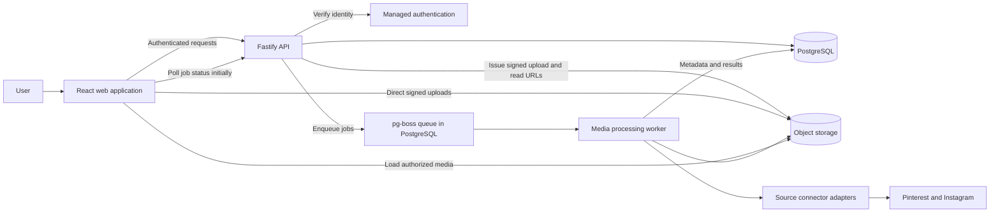
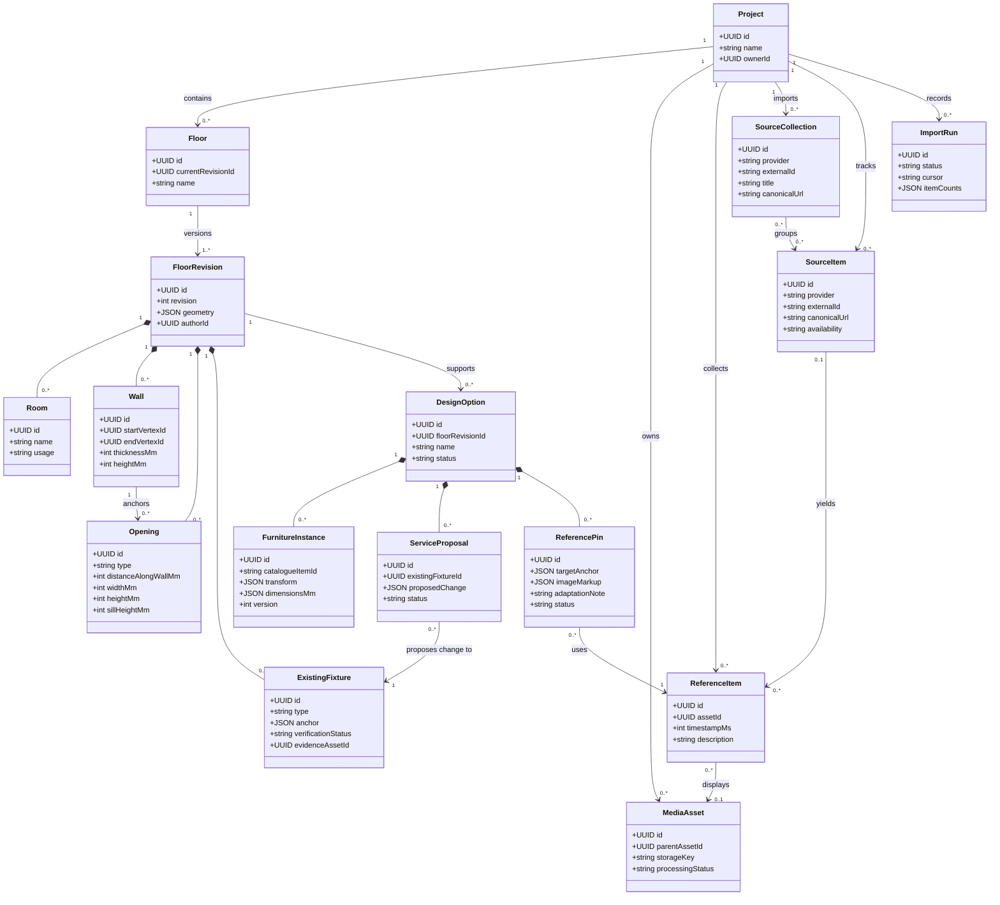
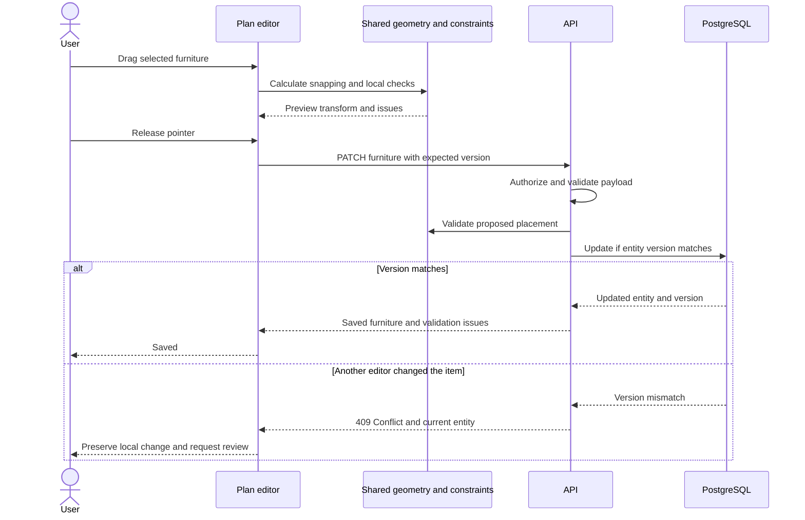
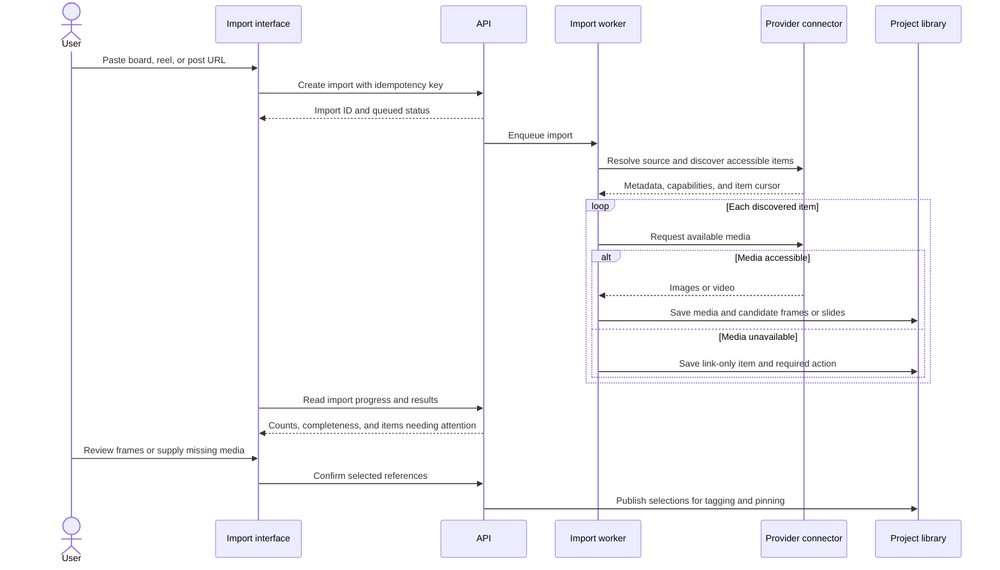

# HomeSpace

A shared interior design workspace that connects your home's floor plan, editable 3D layouts, and visual inspiration.

HomeSpace helps users turn a blueprint into a verified spatial model, arrange furniture, attach references to specific walls and spaces, and compare design options before committing to interiors.

**Pinterest boards and Instagram reels, posts, and carousels are core inspiration sources.** Users should be able to bring their saved inspiration into the same searchable library and pin useful details to actual locations in their home.

> **Status:** Planning stage. This repository currently contains the project design; the application, infrastructure, and commands described below have not been implemented. The technology stack and repository structure are proposed.

## Product workflow

**Upload plan → verify geometry → capture existing conditions → arrange furniture → pin inspiration → compare options → record decisions.**

The first release will support manual tracing and correction of floor plans. Automatic blueprint recognition and assisted design suggestions will follow once the editing and saving workflows are reliable.

| Workspace | Purpose |
| --- | --- |
| House plan | Edit rooms, walls, doors, windows, and existing services |
| Layout planner | Place furniture, inspect clearances, and switch between 2D and 3D |
| Inspiration library | Search images and video frames by room, style, material, and element |
| Design canvas | Arrange references, add notes, and compare visual directions |
| Review and decisions | Discuss locations, resolve issues, and approve choices |

## Planned capabilities

- **Editable house model:** Scale a floor plan, trace irregular rooms, correct openings, and generate matching 2D and 3D views.
- **Furniture planning:** Preview placement, drag, rotate, resize, snap to walls, enter dimensions, and undo changes.
- **Existing-condition mapping:** Record electrical, plumbing, and AC points with source evidence and verification status.
- **Social inspiration imports:** Add Pinterest board/pin links and Instagram reel/post links, import supported account exports, and resolve unavailable media through user-assisted uploads.
- **Reference organization:** Preserve source boards and collections, review distinct video frames and carousel slides, and filter by tags, source, and decision status.
- **Contextual annotations:** Attach a reference or a specific detail within it to a room, wall, furniture item, or floor position.
- **Design alternatives:** Duplicate layouts and compare arrangements without overwriting earlier options.
- **Constraint checks:** Identify overlaps, obstructed openings, access problems, and height conflicts.
- **Shared review:** Invite collaborators, add anchored comments, save checkpoints, and track decisions.

Photorealistic rendering, automatic reconstruction from walkthrough videos, and construction-ready drawings are outside the initial scope. Measurements and site verification remain necessary for final execution.

## Technology stack

| Layer | Proposed technology | Responsibility |
| --- | --- | --- |
| Language | TypeScript | Shared types and domain contracts across the web app, API, and worker |
| Monorepo | pnpm workspaces | Shared packages and consistent dependency management |
| Web application | React + Vite | Application shell and planning workspaces |
| 2D editor | React Konva | Plan interaction, selection, dragging, and annotations |
| 3D viewer | Three.js + React Three Fiber | Walls, openings, furniture, and camera controls |
| Client state | Zustand | Active tools, selection, and temporary interaction state |
| Server state | TanStack Query | Fetching, mutation state, and cache updates |
| Validation | Zod | Shared request, response, and domain validation schemas |
| API | Fastify | Project operations, authorization, and server validation |
| Database | PostgreSQL + Drizzle | Project data, geometry revisions, layouts, and migrations |
| Media storage | S3-compatible object storage | Original uploads, extracted frames, and thumbnails |
| Background jobs | pg-boss | PostgreSQL-backed queues, retries, and processing status |
| Source connectors | Shared TypeScript adapter contracts | Pinterest, Instagram, account-export, and upload import flows |
| Media processing | FFmpeg + Sharp | Video extraction, metadata, previews, and thumbnails |
| Authentication | Managed OIDC-compatible provider; selection pending | Accounts, sessions, and identity verification |
| Testing | Vitest + Playwright | Domain tests, API integration, and critical browser workflows |
| CI | GitHub Actions | Type checks, tests, linting, and build verification |

Specific versions will be pinned when implementation begins. Hosting, authentication provider, and deployment configuration remain decisions to make before the first shared environment.

## System architecture

Use a modular backend with one API process and one background worker. Keep geometry and constraints in shared packages so the browser and server use the same calculations.



Heavy media processing runs outside request handlers. Job progress and per-item failures remain visible to users. Live collaboration notifications can be added after reliable shared saving is established.

## Domain model: UML class diagram

This diagram describes domain relationships. Rooms, walls, openings, and existing fixtures are embedded in immutable floor revision documents; they do not each require a database table initially.



Additional persistence records include project memberships, source collection memberships, per-item import results, provider connections, tag assignments, boards and board items, comments, decisions, activity events, and named checkpoints. Derived assets retain their original asset ID for provenance. A source item can yield multiple reference items, such as reel frames or carousel slides. Link-only references may have no local media asset and must be labelled accordingly.

## Spatial and versioning rules

- Store dimensions in **millimetres**. Use `x` and `z` for floor position and `y` for height; convert to metres at the 3D rendering boundary.
- Use a documented floor origin and rotation convention. Screen pixels are view coordinates and must never be saved as building geometry.
- Represent shared walls once. Room boundaries reference stable wall or vertex IDs.
- Anchor wall-mounted points using distance along the wall and mounting height. Calculate their world positions from wall geometry.
- Keep stable IDs for geometry elements across revisions where possible.
- Save building edits as new floor revisions. Existing design options remain attached to their original revision until deliberately migrated.
- Preserve observed fixture locations. Record proposed relocations separately, with their own approval status.
- Mark inferred dimensions and points as unverified, with evidence and uncertainty information.

Both renderers consume the same spatial model. The 3D scene must not become a separate source of furniture positions.

## Furniture save flow: UML sequence diagram



Pointer movement updates local preview state. Persist the completed operation rather than every drag frame. Reject malformed geometry; report design conflicts as reviewable issues so users can explore unfinished layouts.

## Editing, saving, and collaboration

Editor modes are explicit: **View**, **Place furniture**, **Move furniture**, **Edit building**, **Edit services**, and **Place reference**. Escape cancels an unfinished action or returns to View mode. Keyboard shortcuts must respect focused text inputs.

| State category | Examples | Owner |
| --- | --- | --- |
| Shared project state | Geometry, furniture, pins, comments | Server |
| Temporary interaction state | Drag preview, hover, active tool | Client |
| Personal view preferences | Camera, filters, visible layers | Local or per-user settings |

The first shared-editing implementation uses optimistic updates and entity versions. Stale writes return `409 Conflict` instead of overwriting another person's work. Geometry saves check the expected floor revision. Temporary local edits remain recoverable after connection failures.

Provide visible **Saving**, **Saved**, **Offline**, and **Conflict** states, undo/redo, and named checkpoints. Later, add live change notifications and presence. Shared editing does not initially require simultaneous live dragging.

## Inspiration and media pipeline

**Add source → discover items → acquire available media → extract useful views → review → tag → publish → pin to the house.**

### Supported source experiences

| Input | Intended import experience | Required fallback |
| --- | --- | --- |
| Pinterest board URL, including short links | Resolve the board, discover accessible pins, and preserve board title and pin sources | Import available items; identify missing items and accept exports or uploads |
| Pinterest pin URL | Create a reference with accessible image/video media and source metadata | Keep a labelled link-only item when media cannot be acquired |
| Instagram reel URL | Preserve caption and creator attribution, acquire accessible video, and extract distinct interior views | Ask for a user-provided video when only metadata or an embed is available |
| Instagram post/carousel URL | Preserve post identity, accessible media, and slide ordering | Report partial slide coverage and accept missing images as uploads |
| Account export or saved-item list | Parse supported formats, preview named boards/collections, and let the user choose what to import | Treat exported URLs as sources to resolve; an export may not contain the underlying media |
| Uploaded images and videos | Process user-provided media directly, optionally linked to an existing social source | Keep unsupported files visible with an actionable error |

Direct URL entry belongs in the first-release interface. Full media acquisition depends on the provider's available APIs, account permissions, and content access. A public link or successful embed does not guarantee downloadable media. Support should be verified through an early integration spike, and published capability limits should reflect what has actually been tested.

Use provider-supported APIs and authorization where available. Consumer saved collections and private boards may require exports or user-assisted uploads; do not assume account connection grants access to every saved item. Keep provider connection credentials encrypted and separate from application login. Users should not need to submit social passwords or session cookies.

### Importer architecture

Define a connector contract for URL resolution, capability reporting, paginated item discovery, metadata retrieval, and permitted media acquisition. Each connector reports which operations are available for a particular source. Export-file and direct-upload importers feed the same downstream pipeline.

Separate discovery from media acquisition: knowing that a reel exists is different from having its video available for analysis. Store a durable `SourceItem` before media processing so inaccessible items remain reviewable.

Each import run should record:

- The project, requesting user, source, selected collection, and access method.
- The persisted pagination cursor and per-item progress for resumable imports.
- Counts for discovered, imported, duplicate, link-only, unavailable, failed, and awaiting-action items.
- Provider-reported totals when available, with an explicit unknown-total state otherwise.
- Whether all source pages/slides were traversed, plus any configured limits or interrupted discovery.

Use statuses such as `queued`, `discovering`, `processing`, `awaiting_user_action`, `completed`, `partial`, `failed`, and `cancelled`. Respect provider rate limits and retry guidance. Retries should resume failed work without duplicating successful items.

Within a project, deduplicate source items using provider identity and external ID, with canonical URL fallback. Track source collection membership separately so one pin can belong to multiple imported boards. Use content hashes for identical media and perceptual similarity to suggest near duplicates; preserve provenance when grouping them.

Reimporting a source should add newly discovered items and update availability while preserving local tags, notes, shortlists, and spatial pins. An item disappearing remotely must not silently remove planning work. Store acquired media when permitted and available; remote media URLs can expire.

### Social import flow: UML sequence diagram



### Frame selection and contextual organization

- Preserve original media, source URLs, creator attribution, captions, collection membership, and import timestamps. Extracted frames retain source timestamps and parent asset IDs; carousel slides retain their indices.
- Use scene changes, image quality, and perceptual similarity to suggest distinct frames. A whole-house tour should retain different spaces; a kitchen pan should collapse repetitive views. Avoid fixed frame counts or silent carousel truncation.
- Let users scrub videos, capture additional frames, recover rejected images, and confirm import completeness. Show processing progress and per-item failures.
- Keep each reel/post as a parent group so users can trace a crop or frame back to its original context.
- Suggest room, style, material, and element tags, then let users correct them. Track tag author, confidence, and confirmation status. Provider metadata can be imported immediately; visual tagging requires a separately selected analysis model or service.
- Search and filter by source board/collection, creator, room, style, material, element, and decision status. Semantic search is a later extension.
- Offer reviewed references for wall and room pinning with adaptation notes. Keep manual approval before changing layouts.

Reference pins support room, wall, furniture, and free-position anchors. Image markup uses normalized image coordinates so crops and callouts survive thumbnail resizing. If an anchor is removed or invalidated, flag the pin for review.

## Constraint engine

Inputs are a floor revision, design option, furniture definitions, and configurable clearance rules. Each result includes a rule ID, severity, affected objects, explanation, relevant geometry, and the input revision.

Initial rules cover furniture overlap, placement outside usable boundaries, blocked door swings and sliders, circulation gaps, service access, and height clashes. Use rotated footprints and vertical intervals for furniture checks.

Client checks provide immediate feedback; server checks validate committed changes. Results become stale when their inputs change. A layout with no detected issues is not automatically site-verified or construction-approved.

## API outline

| Method and route | Purpose |
| --- | --- |
| `POST /projects` | Create a project |
| `GET /projects/:id` | Read project metadata and access information |
| `POST /floors/:id/revisions` | Save a building revision |
| `POST /design-options` | Create or duplicate an option |
| `GET /design-options/:id` | Load a layout and its annotations |
| `PATCH /furniture/:id` | Update dimensions or placement |
| `POST /design-options/:id/validate` | Run constraint checks |
| `POST /assets/upload-url` | Request a signed upload URL |
| `POST /assets/:id/complete` | Verify upload and schedule processing |
| `GET /jobs/:id` | Read processing progress |
| `POST /projects/:id/imports` | Start a URL, export-file, or uploaded-media import |
| `GET /imports/:id` | Read source coverage, progress, and item results |
| `POST /imports/:id/retry` | Resume retryable or newly resolved items |
| `POST /imports/:id/cancel` | Cancel outstanding work |
| `POST /source-items/:id/media` | Attach user-provided media to an unresolved source |
| `POST /source-collections/:id/refresh` | Reimport without discarding local planning work |
| `GET /projects/:id/references` | Search and filter references |
| `POST /reference-pins` | Attach inspiration to a location |
| `POST /comments` | Add an anchored comment or reply |
| `POST /design-options/:id/checkpoints` | Save a named checkpoint |

Use shared Zod contracts and a consistent error envelope. Authorize every project-scoped operation. Require expected versions for mutable records, make retry-sensitive operations idempotent, and paginate collections.

## Proposed repository structure

```text
apps/
  web/                  # React application and planning workspaces
  api/                  # Fastify routes, authorization, domain services
  worker/               # Media processing and background jobs
packages/
  contracts/            # Shared schemas and API types
  importers/            # Provider, export-file, and upload connector contracts
  geometry/             # Coordinate transforms and spatial calculations
  constraints/          # Placement and clearance checks
  database/             # Drizzle schema, migrations, and queries
  ui/                   # Shared interface components
docs/
  architecture/         # Detailed designs and interaction contracts
  decisions/            # Architecture decision records
  api/                  # API examples and integration notes
```

## Two-developer ownership

Split ownership by feature area while reviewing shared contracts together. Each milestone should produce an integrated workflow.

| Area | Developer A | Developer B |
| --- | --- | --- |
| Foundation | Web shell, editor state, coordinates | API, auth, database, storage |
| House model | Geometry, tracing, openings | Persistence and geometry revisions |
| Planner | 2D/3D, furniture manipulation | Catalogue and layout APIs |
| Inspiration | Spatial pins, frame review, and annotation interactions | Pinterest/Instagram adapters, imports, library, search, canvas |
| Validation | Geometry and constraint calculations | Server integration and issue persistence |
| Collaboration | Save states and conflict resolution UI | Membership, comments, version checks |
| Delivery | Planner browser workflows | CI, deployment, monitoring, workers |

Agree on coordinate conventions and contracts before parallel implementation. Share sample-home fixtures, use short-lived branches, and review schema and contract changes together. Add migrations through version control and integrate frequently.

## Implementation roadmap

Build in eight phases. Phases 1–6 deliver a usable shared planning product; phases 7–8 add optional AI assistance. Existing measurements, layout editing, and deterministic constraint checks do not depend on AI.

| Phase | Scope | Completion gate |
| --- | --- | --- |
| 1. Validate and agree | Test Pinterest/Instagram access paths; agree on coordinates, schemas, and the first-room fixture | Supported imports and fallbacks are documented; both developers use the same contracts |
| 2. Foundation | Scaffold the monorepo, authentication, projects, database, storage, jobs, and CI | Both developers can run the project; an authorized user can upload and reopen a plan |
| 3. Plan and inspiration tracks | In parallel, build manual 2D tracing and the social/media library with frame review and manual tags | A corrected room and reviewed inspiration survive save/reload; partial imports are visible |
| 4. Interactive layouts | Build furniture manipulation, synchronized 3D, and a movable reference canvas | Furniture moves predictably in both views; references and notes can be arranged and restored |
| 5. Contextual planning | Anchor references to spaces; map electrical points; add clearances and conflict checks | Users can connect an idea to a wall and understand real placement constraints |
| 6. Shared beta | Add alternatives, comments, version conflicts, checkpoints, exports, and release hardening | Two users can review and revise without lost edits; the complete home-planning flow passes |
| 7. AI inspiration assistance | Suggest room/style/material tags and distinct useful reel frames | Users can accept or correct suggestions; quality, processing time, and cost are evaluated |
| 8. AI drafting and recommendations | Suggest blueprint geometry and reference-to-space design options | Suggestions remain editable drafts with evidence, verification, and constraint validation |

**Developer A** leads geometry, the planner, and spatial interactions. **Developer B** leads the backend, imports, media library, and persistence. The plan and inspiration tracks run in parallel from phase 3; shared contracts and integration reviews continue throughout.

See the [detailed phase plan](docs/architecture/implementation-phases.md) for deliverables, dependencies, ownership, and acceptance criteria. Each phase is complete only when its integrated workflow passes its gate; phase numbers are not delivery dates.

**First end-to-end acceptance scenario:** Create a living room from a plan, correct a door, place two sofas and a TV unit, attach three references, identify a socket conflict, save an alternative layout, and reopen everything without losing state.

**Social import acceptance scenario:** Import a Pinterest board and an Instagram house-tour reel through supported access paths. Review source completeness, retain distinct room views, tag them, and pin a chosen detail to the living room. Reimport without duplicates or lost notes. Verify the fallback workflow for a private/deleted post or an export containing only links, and visibly report a partially available carousel.

## Quality, security, and operations

- Test geometry transforms, rotated footprints, snapping, opening clearances, and height-sensitive conflicts with Vitest.
- Test authorization, version conflicts, persistence, and job transitions against PostgreSQL.
- Test provider adapters with sanitized recorded fixtures, including pagination, short-link resolution, expired media, authentication failures, rate limits, duplicate retries, and partial carousel results. Keep live provider checks separate from deterministic CI tests.
- Use Playwright for the first acceptance scenario, save/reload behavior, and recovery from failed requests.
- Run type checks, linting, tests, and builds in CI once the application is scaffolded.
- Keep the 2D plan and project data accessible if the 3D renderer fails. Add error boundaries and actionable error messages.
- Keep media private, use signed URLs, validate uploads, and bound worker execution time and resource usage.
- Validate source URLs and every redirect; block internal-network destinations. Authorize access to imported private content per project and keep provider credentials out of logs and exports.
- Store secrets outside version control. Add structured logs, browser error reporting, job failure reporting, and database backups with restore verification.

## Local development

Setup commands will be added with the initial scaffold. There are currently no application scripts or services to run.

Expected prerequisites are a supported Node.js LTS release, pnpm, PostgreSQL, S3-compatible storage, and FFmpeg for the media worker. Planned local services can run through Docker Compose.

Before scaffolding, confirm the authentication provider, hosting target, environment configuration, initial furniture catalogue format, and tested Pinterest/Instagram import capabilities and access requirements.
